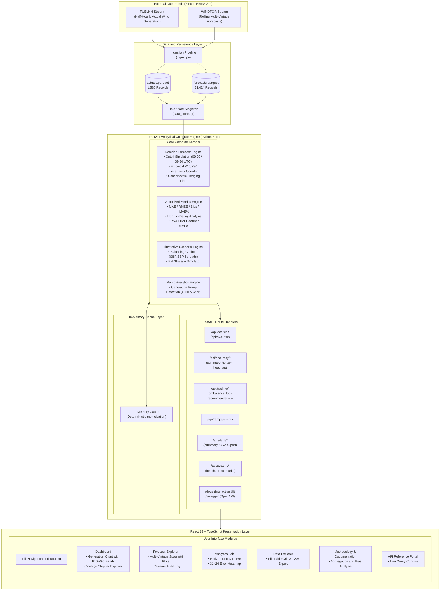

# WindLedger

UK Day-Ahead Wind Generation Decision and Forecast Accuracy Evaluation Platform.

---

## 1. AI Disclosure

In accordance with the project submission guidelines:

* **AI Tools Utilized:** This project was developed with assistance from Google Antigravity AI coding assistant, utilizing Google DeepMind Gemini models.
* **Scope of AI Assistance:** AI assistance was employed for boilerplate architecture setup, initial test scaffolding, CSS styling refinement, and markdown formatting.
* **Human Verification & Audits Performed:**
  * Audited and verified all mathematical formulas (MAE, RMSE, bias, nMAE percentage, and P10–P90 empirical error percentiles).
  * Validated the Elexon BMRS ingestion logic against official API specifications for `/datasets/WINDFOR/stream` and `/datasets/FUELHH/stream`.
  * Verified strict non-lookahead adherence for decision cutoff logic (D-1 cutoff timestamps).
  * Audited period counts and temporal resolution alignment (aggregating 1,488 half-hourly settlement periods into 744 hourly intervals).
  * Executed the automated test suite (34 passing unit and integration tests).

---

## 2. System Architecture



---

## 3. Live Application and API Links

| Service | Platform | Link | Description |
| :--- | :--- | :--- | :--- |
| **Frontend Portal (UI)** | **Vercel** | [https://windledger.vercel.app](https://windledger.vercel.app) | React 19 trading dashboard with decision cutoff simulation and market analytics |
| **Backend API (REST)** | **Render** | [https://windledger-api.onrender.com](https://windledger-api.onrender.com) | FastAPI Python backend serving analytical and data endpoints |
| **Interactive API Documentation** | **Custom Portal** | [https://windledger-api.onrender.com/docs](https://windledger-api.onrender.com/docs) | Interactive API documentation portal with live query execution |
| **OpenAPI Specification** | **OpenAPI 3.1** | [https://windledger-api.onrender.com/swagger](https://windledger-api.onrender.com/swagger) | Standard Swagger UI OpenAPI specification |

> **Note on Free-Tier Hosting (Render):**  
> The backend is hosted on a free Render web service. If the service has been idle, Render automatically spins down the container. Initial access in incognito mode may take **30–50 seconds** while the instance cold-starts and warms its in-memory Parquet cache. Once awake, all requests resolve immediately.

---

## 4. Methodology and Data Correctness

### 4.1 Datasets Implemented

The platform directly ingests from the two official Elexon Insights Solution streams:
1. **Actual Wind Generation (`FUELHH`)**: Metered outturn for `fuelType="WIND"`. Resolution: **30-minute settlement periods** (48 periods per day, 1,488 periods across January 2026).
2. **Forecasted Wind Generation (`WINDFOR`)**: National wind forecast runs published multiple times daily across varying horizons. Resolution: **60-minute hourly intervals** (24 hours per day, 744 intervals across January 2026).

### 4.2 Temporal Alignment and Settlement Aggregation

Because settlement actuals (`FUELHH`) arrive at 30-minute intervals and forecasts (`WINDFOR`) arrive at 60-minute intervals:
* For each target delivery hour, the two corresponding 30-minute settlement outturn values (e.g., 00:00–00:30 and 00:30–01:00) are averaged into a single ground-truth hourly outturn (MW).
* This yields exactly **744 evaluated hourly delivery periods** covering 100% of January 2026.
* Labels across the dashboard and API explicitly distinguish between the **744 hourly delivery periods** and the underlying **1,488 settlement half-hours**.

### 4.3 Verified Metrics and Root Cause of the +1,852 MW Bias

Recomputing metrics directly from the raw Parquet datasets (`python scripts/verify_metrics.py`) at the default D-1 09:20 UTC cutoff confirms:

| Metric | Value | Interpretation |
| :--- | :--- | :--- |
| **Evaluated Periods** | 744 hours | Complete coverage of January 2026 (31 days × 24 hours) |
| **Mean Forecast** | 13,432.6 MW | Average day-ahead decision forecast |
| **Mean Actual Outturn** | 11,580.7 MW | Average metered wind generation |
| **Mean Error (Bias)** | **+1,851.9 MW** | Positive bias (forecast exceeding metered actuals) |
| **Mean Absolute Error (MAE)** | **2,142.1 MW** | Average magnitude of forecast error |
| **Root Mean Square Error (RMSE)** | **2,611.7 MW** | Error variance metric |
| **Normalized MAE (nMAE)** | **18.50%** | MAE divided by mean actual outturn |
| **Periods with Error > 1 GW** | **75.5%** | Percentage of hours with absolute error above 1,000 MW |

**Why is there a +1.85 GW forecast bias?**
1. **Transmission vs. Embedded Wind Coverage:** In Great Britain, `FUELHH` only measures Balancing Mechanism Units (BMUs) connected directly to the high-voltage transmission network. Smaller distribution-connected ("embedded") wind farms generate power locally without appearing in `FUELHH` transmission-metered wind. Conversely, National Grid ESO's `WINDFOR` model forecasts total GB wind generation.
2. **Storm Activity and Curtailment:** January 2026 saw significant storm activity (e.g., Storm Gorel) across the UK. During storm surges, turbines were commercially turned down via Balancing Mechanism bids to avoid local transmission bottlenecks, or automatically disconnected when wind speeds exceeded high-wind turbine cut-out limits (~25 m/s).
3. **Reproducibility:** A standalone audit script is included in the repository. Run:
   ```bash
   python backend/scripts/verify_metrics.py
   ```

### 4.4 Day-Ahead Market Gate Closures

Trading decisions are evaluated on day **D-1** ahead of delivery on day **D**:
* **EPEX SPOT GB Day-Ahead Auction:** Order book closes daily at **09:20 UK time (same as UTC in January)**. Results published from 09:30.
* **Nord Pool N2EX GB Day-Ahead Auction:** Order book closes daily at **09:50 UK time (same as UTC in January)**. Results published by 10:00.

The application strictly filters `publishTime <= cutoff` on day D-1, ensuring zero lookahead bias. Any forecast published after cutoff is marked `"published after cutoff, not used"`.

### 4.5 Scope and Illustrative Features

The core scope of the project focuses on Elexon wind actuals and forecasts. Additional features provided in the platform:
* **Balancing Cashout Risk & Bid Strategy Modeling:** Use illustrative BSC System Buy/Sell Price assumptions and are explicitly labeled as illustrative scenario models rather than core historical outturns.
* **P10–P90 Uncertainty Bands & Conservative Line:** Derived from empirical historical error quantiles prior to delivery day D (no lookahead leakage) and drawn directly on the primary dashboard chart.

---

## 5. Technology Stack

* **Frontend:** React 19, TypeScript, Vite, TanStack React Query v5, Recharts, Vanilla CSS Design System.
* **Backend:** Python 3.11+, FastAPI, Pandas, NumPy, PyArrow, Uvicorn, pytest, httpx.
* **Data Storage:** Columnar Apache Parquet (Snappy compression).
* **Cloud & DevOps:** Docker, Docker Compose, Vercel (`vercel.json`), Render / Heroku (`render.yaml`, `Procfile`).

---

## 6. Repository Files and Structure

```text
├── .gitignore                      # Git exclusion rules
├── docker-compose.yml              # Container orchestration (backend + frontend)
├── package.json                    # Workspace forwarder scripts
├── Procfile                        # Heroku / cloud process definition
├── README.md                       # System documentation and audit report
├── render.yaml                     # Render infrastructure-as-code blueprint
├── vercel.json                     # Vercel SPA routing configuration
│
├── backend/                        # FastAPI Analytical Backend
│   ├── Dockerfile                  # Container definition
│   ├── Procfile                    # Backend process definition
│   ├── requirements.txt            # Python dependencies
│   ├── runtime.txt                 # Target runtime (python-3.11.9)
│   │
│   ├── app/
│   │   ├── main.py                 # FastAPI application factory and CORS middleware
│   │   ├── data_store.py           # In-memory Parquet loader and data store
│   │   ├── schemas.py              # Pydantic v2 schemas and validation models
│   │   │
│   │   ├── ingestion/              # Elexon BMRS data ingestion
│   │   │   ├── elexon_client.py    # Async streaming client for BMRS API
│   │   │   └── ingest.py           # Ingestion script for FUELHH and WINDFOR
│   │   │
│   │   ├── routers/                # Modular API endpoints (18 operational endpoints)
│   │   │   ├── accuracy.py         # Statistical metrics endpoints (MAE, RMSE, heatmap)
│   │   │   ├── data.py             # Parquet dataset summary and CSV streaming
│   │   │   ├── docs_ui.py          # Custom interactive API documentation portal
│   │   │   ├── forecast.py         # Point-in-time decision forecasts & revisions
│   │   │   ├── meta.py             # Date ranges and operational metadata
│   │   │   ├── ramps.py            # Wind generation ramp event detection
│   │   │   ├── system.py           # Process health status and memory tracking
│   │   │   └── trading.py          # Illustrative cashout risk and bidding models
│   │   │
│   │   └── services/               # Core computational engines
│   │       ├── decision_forecast.py# Cutoff selection, uncertainty quantiles, caching
│   │       ├── metrics.py          # Vectorized metrics, horizon decay, error heatmap
│   │       ├── ramps.py            # Ramp rate calculation and tracking
│   │       └── trading.py          # Illustrative balancing cashout model
│   │
│   ├── data/                       # Ingested Elexon BMRS Parquet Datasets
│   │   ├── actuals.parquet         # 1,585 FUELHH actual wind generation records
│   │   └── forecasts.parquet       # 21,024 WINDFOR multi-vintage forecast records
│   │
│   ├── scripts/
│   │   └── verify_metrics.py       # Standalone mathematical audit and verification script
│   │
│   └── tests/                      # Automated Test Suite (34 tests)
│       ├── test_api.py             # Core API route integration tests
│       ├── test_decision.py        # D-1 cutoff adherence and horizon tests
│       ├── test_enterprise_api.py # System health, ramp events, CSV export tests
│       ├── test_metrics.py         # Metric calculation and heatmap tests
│       ├── test_ramps.py           # Ramp event detection tests
│       └── test_trading.py         # Scenario modeling tests
│
└── frontend/                       # React 19 Frontend Application
    ├── Dockerfile                  # Production container definition
    ├── index.html                  # HTML entry point
    ├── nginx.conf                  # Production reverse proxy config
    ├── package.json                # Frontend dependencies and build scripts
    ├── tsconfig.json               # TypeScript compiler config
    ├── vercel.json                 # Vercel client-side routing config
    ├── vite.config.ts              # Vite configuration and proxy
    │
    └── src/
        ├── App.tsx                 # Root application shell and navigation
        ├── main.tsx                # React DOM root entry
        ├── index.css               # Vanilla CSS design system
        ├── api.ts                  # API client bindings
        │
        ├── pages/
        │   ├── Dashboard.tsx       # Primary dashboard with P10-P90 band & vintage list
        │   ├── ForecastExplorer.tsx# Trajectory revisions and post-cutoff labeling
        │   ├── Analytics.tsx       # Horizon decay curves and 31x24 error heatmap
        │   ├── DataExplorer.tsx    # Filterable data grid and CSV export
        │   ├── Settings.tsx        # Methodology and dataset documentation (Method)
        │   └── ApiReference.tsx    # Interactive API documentation portal
        │
        ├── components/
        │   ├── SearchModal.tsx     # Global command palette (Ctrl+K)
        │   ├── NotificationPopover.tsx # Scenario trading alerts popover
        │   └── ProfileDropdown.tsx # Session and methodology status dropdown
        │
        └── utils/
            └── formatDate.ts       # Strict UTC time and decision date formatting
```

---

## 7. How to Start the Application

### Option 1: Live Cloud Deployment (No Installation Required)

Access the live cloud deployment directly in your browser:
* **Frontend Portal:** [https://windledger.vercel.app](https://windledger.vercel.app)
* **Backend API & Docs:** [https://windledger-api.onrender.com/docs](https://windledger-api.onrender.com/docs)

---

### Option 2: Docker Compose (Single Command)

Runs both the FastAPI backend and the React Nginx frontend in isolated containers:

```bash
# 1. From repository root:
docker compose up --build
```
* Frontend Web App: `http://localhost:3000`
* Backend API & Documentation: `http://localhost:8000/docs`

To stop:
```bash
docker compose down
```

---

### Option 3: Local Development (Manual Setup)

#### 1. Backend (FastAPI)
```bash
cd backend

# Create virtual environment
python -m venv venv

# Activate virtual environment
# Windows:
venv\Scripts\activate
# macOS/Linux:
source venv/bin/activate

# Install dependencies
pip install -r requirements.txt

# Run verification script
python scripts/verify_metrics.py

# Run test suite (34 tests)
python -m pytest -v

# Start FastAPI server
python -m uvicorn app.main:app --host 127.0.0.1 --port 8000 --reload
```

#### 2. Frontend (React 19 + Vite)
In a separate terminal:
```bash
cd frontend

# Install dependencies
npm install

# Build check
npm run build

# Start Vite dev server
npm run dev
```

---

## 8. Verification and Test Results

The backend contains 34 automated unit and integration tests covering data integrity, cutoff adherence, horizon positivity, metric math, and endpoint contracts:

```bash
cd backend
python -m pytest -v
```

**Test Coverage Summary (34/34 passing in ~1.7s):**
* `test_api.py`: Endpoint availability and schema conformance.
* `test_decision.py`: Strict D-1 cutoff adherence (no lookahead bias), 24-hour delivery completeness, and uncertainty band properties.
* `test_metrics.py`: Mathematical correctness of MAE, RMSE, bias, nMAE, horizon decay, and 31×24 heatmap matrix.
* `test_enterprise_api.py`: Data summary, CSV export streaming, and system health status.
* `test_ramps.py`: Ramp detection threshold logic.
* `test_trading.py`: Illustrative balancing cashout risk and bidding calculations.

---

## 9. License

MIT License.
